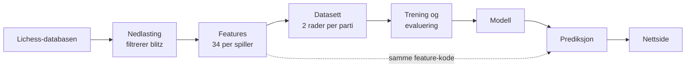
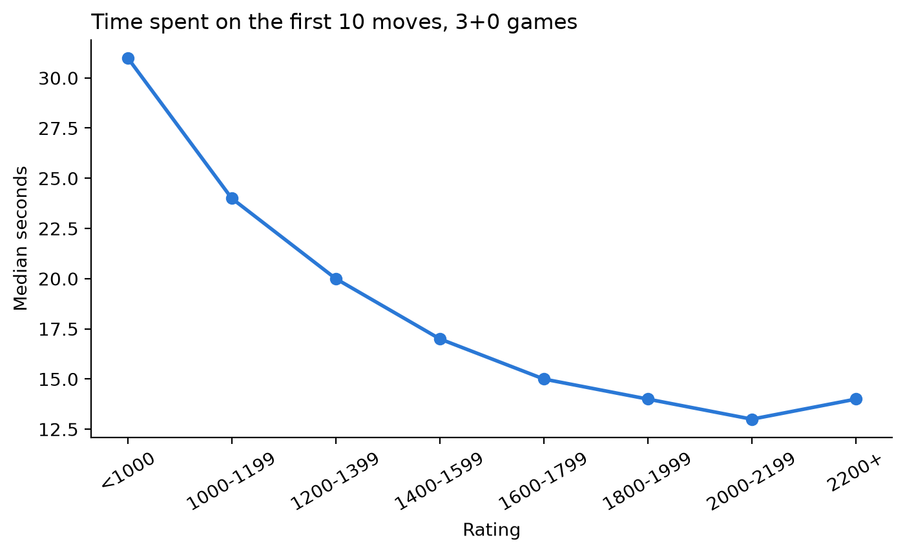
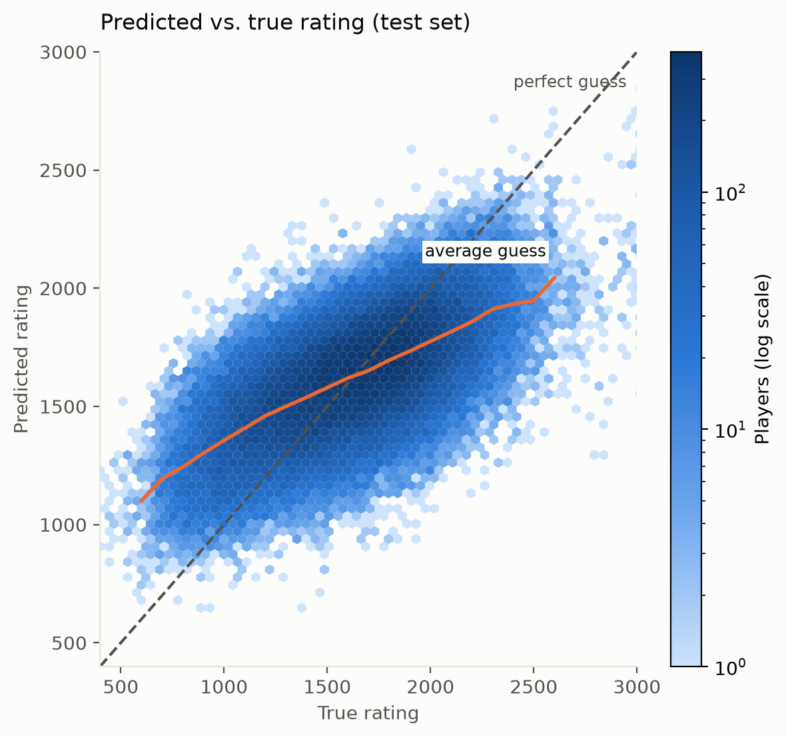
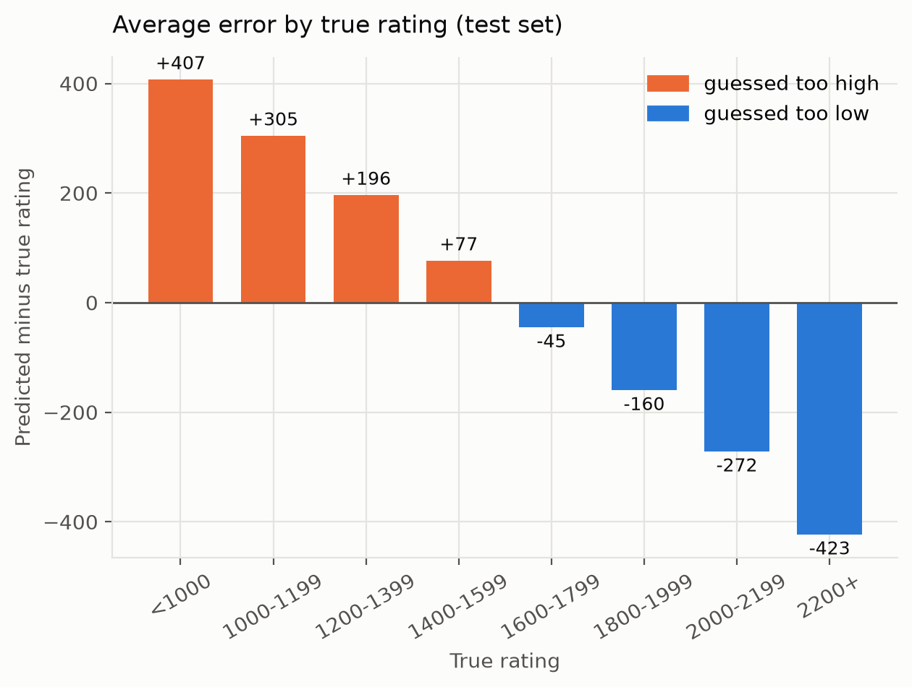
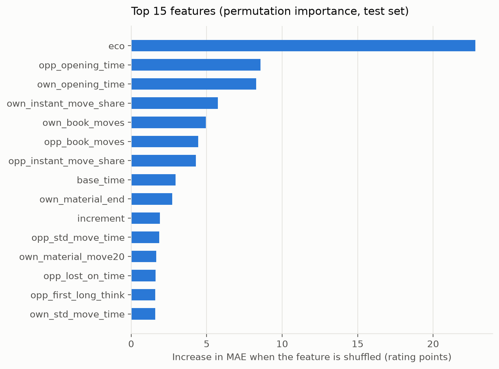
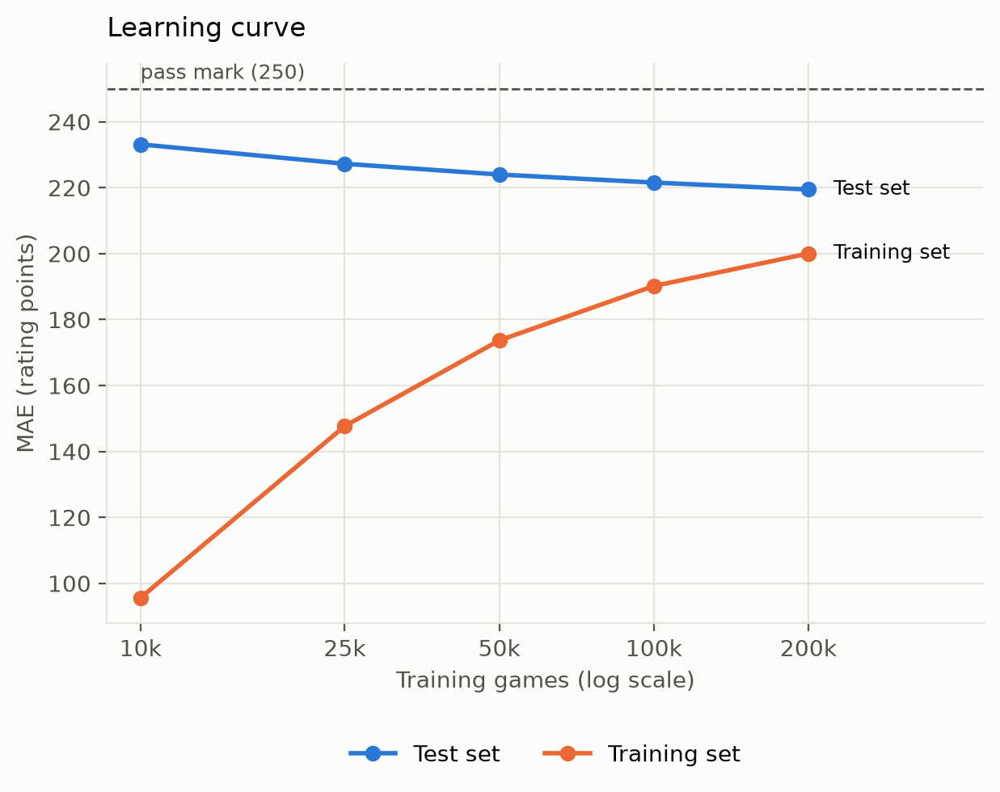
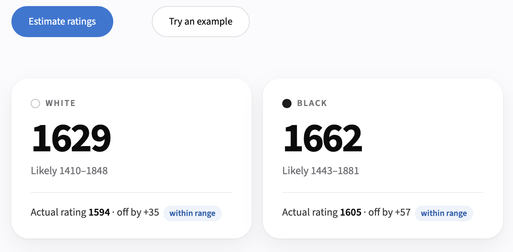

# Lichess sjakk-ratingestimator

Jonas Kjerstad Solevåg, oktober 2026

*Individuelt prosjekt i DAT158 Maskinlæring og videregående algoritmer, Høgskulen på Vestlandet.*

## 1: Beskriv problemet

### Omfang

Det er vanskelig å vite hvor sterk en sjakkspiller er ut fra ett enkelt parti. I dette prosjektet har jeg laget en nettside som anslår ratingen til begge spillerne i et Lichess blitz-parti, bare ut fra trekkene, resultatet og klokketidene. Modellen ser aldri spillernes ekte rating. Finnes den i partiet, fjernes den før modellen ser noe, og vises først etterpå til sammenligning.

Jeg bruker maskinlæring fordi spillestyrke ikke viser seg i én enkelt ting, men i mange små signaler samtidig: hvilken åpning som spilles, hvor raskt trekkene kommer, hvor ofte brikker blir hengende, og hvordan partiet ender. Ingen enkel regel fanger alt dette, men en modell kan lære av mange eksempler hvordan signalene henger sammen med rating. Det som gjør det mulig i stor skala, er at fasiten følger gratis med: hvert Lichess-parti inneholder begge spillernes rating.

Løsningen er for sjakkspillere som vil vite omtrent hvilket nivå de selv eller en motstander spilte på i ett parti, og for trenere som vil få et raskt inntrykk av en spiller. Den passer også til «Guess the Elo», der man gjetter ratingen ut fra et parti. Det er et anslag med usikkerhet, ikke et ratingsystem: ett parti er begrenset bevis, og det er den offisielle ratingen som teller.

I dag gjøres dette på to måter. Manuelt kan erfarne spillere gjette nivået ved å se partiet, som i GothamChess sin videoserie «Guess the Elo» (GothamChess, u.å.). Det er tidkrevende, og jeg fant ingen studie som måler hvor presise slike gjetninger er. Automatisk gir Chess.com Game Review en «Game Rating» for et parti, men den bruker spillerens ekte rating som utgangspunkt (Chess.com, u.å.), så den løser ikke samme oppgave. I forskning har Tijhuis mfl. (2023) plassert spillere i ratinggrupper med random forest og 30 håndlagde features, og Omori og Tadepalli (2024) oppnådde en gjennomsnittlig feil på 183 ratingpoeng i blitz med et dypt nevralt nettverk. Min løsning ser aldri ratingen, er gratis og svarer vanligvis på under ett sekund.

*Figur 1: Systemets deler. Feature-koden brukes både i treningen og i appen.*

Systemet består av sju deler som bygger på hverandre (figur 1). En endring forplanter seg nedover: endres featurene, må datasettet bygges på nytt og modellen trenes og evalueres på nytt, ellers får appen andre tall enn modellen lærte av. Derfor ligger all feature-kode i én fil som brukes både i treningen og i appen.

Prosjektet er gjort av én person på ca. 40 timer. All trening og evaluering ble kjørt på en vanlig bærbar PC, og appen hostes gratis. En stasjonær PC med kraftig grafikkort var tilgjengelig og ble brukt til å teste prosjektet på Windows, men trebaserte modeller trenger ikke grafikkort. Jeg valgte håndlagde features og trebaserte modeller fremfor et dypt nevralt nettverk fordi de trenes på minutter, er godt egnet for tabelldata, kan forklares med feature importance og er en del av pensum. Et dypt nettverk som hos Omori og Tadepalli (2024) ville krevd mer tid enn prosjektets ramme.

### Metrikker

Hovedmetrikken er **MAE** (mean absolute error): hvor mange ratingpoeng modellen bommer med i gjennomsnitt. Har en spiller 1500 og modellen gjetter 1700, er bommen 200, og MAE er snittet av bommene over alle spillere. MAE er lett å forstå og vises direkte i appen som et «±»-intervall, så metrikken henger sammen med det brukeren ser. I tillegg rapporteres **RMSE**, som straffer store bom hardere, og **R²**, som viser hvor stor andel av variasjonen i rating modellen forklarer (0 er ikke bedre enn snittet, 1 er perfekt). Som programvaremetrikk måles svartiden i appen.

For å vise at modellen faktisk har lært noe, sammenlignes den med en enkel **baseline**: en «lat gjetter» (DummyRegressor) som alltid gjetter gjennomsnittsratingen. Suksesskriteriet ble satt 17. oktober, før første trening, så det ikke kunne tilpasses resultatet:

- **ML:** MAE på testsettet er høyst 250 poeng, og lavere enn den late gjetterens.
- **Fungerer for alle Lichess blitz-partier,** enten de limes inn eller hentes med lenke.
- **Ingen ratinglekkasje:** modellen ser aldri den ekte ratingen, og tester beviser det.
- **Tydelige feilmeldinger** ved ugyldig input, for eksempel ødelagt PGN, varianter, for korte partier eller andre tidskontroller enn blitz.
- **Svar på under ett sekund.**

Antall brukere og brukertilfredshet, som også er vanlige suksessmål, kunne ikke måles ærlig i prosjektperioden. De er naturlige mål etter lansering.

## 2: Data

**Kilde og fasit.** Dataene er fra Lichess sin åpne database, som er fri til all bruk (CC0) (Lichess, u.å.-c). Jeg brukte september 2026, som har 89,6 millioner ratede partier. Hvert parti er lagret som PGN-tekst med trekk, klokketid etter hvert trekk og headere med blant annet tidskontroll og resultat. Fasiten er hver spillers rating før partiet, som også står i headerne. Lichess beregner rating med Glicko-2 (Lichess, u.å.-b). Fasiten er støyete: ratingen svinger fra parti til parti, og nye spillere har en foreløpig rating med stor usikkerhet. Foreløpige ratinger er ikke merket i filen, så de kunne ikke filtreres bort.

**Andre kilder.** Chess.com sitt API gir bare partiene til én spiller om gangen, så man må velge spillere først, noe som gir et skjevt utvalg. ChessBase, Chessgames.com og lignende databaser inneholder mest mesterpartier, har et smalt ratingspenn, mangler klokketider og er ikke fritt lisensiert. Lichess var den eneste kilden som var gratis, fritt lisensiert og hadde alle nivåer med klokketider.

**Filtrering og utvalg.** Månedsfilen er 29 GB komprimert, så den strømmes og leses parti for parti, og nedlastingen stopper når nok partier er beholdt. Jeg valgte bare blitz. I en måling av de første 500 000 partiene var 46 % blitz, mer enn noen annen tidskontroll, og ett ratingbasseng gjør fasiten sammenlignbar. Blitz er definert med Lichess sin formel: grunntid + 40 × tillegg mellom 180 og 479 sekunder. Tabell 1 viser filtreringen.

*Tabell 1: Filtrering av partiene.*

| Steg | Partier |
|---|---:|
| Lest fra Lichess | 561 093 |
| Fjernet: ikke blitz | 301 707 |
| Fjernet: kortere enn 20 halvtrekk | 8 679 |
| Fjernet: avbrutt eller regelbrudd | 707 |
| **Beholdt** | **250 000** |

En begrensning er at filen er sortert etter tid, så de første 250 000 partiene er alle fra natten til 1. september. Et utvalg fordelt over hele måneden ville vært mer representativt. Hvor mye data som trengs, vises med en læringskurve i seksjon 3.

**Representasjon og features.** Hvert parti blir to rader, én per spiller. En rad inneholder spillerens egne features, motstanderens features og fargen, og fasiten er spillerens rating. Det dobler datamengden og lar én modell brukes for begge farger. Motstanderens spill er nyttig fordi Lichess parer spillere på likt nivå. Hver spiller får 34 features i seks grupper (tabell 2). Utgangspunktet var min egen erfaring som sjakkspiller, at sterke spillere kan åpningen og spiller den raskt, supplert med ideer fra Tijhuis mfl. (2023).

*Tabell 2: Feature-gruppene, per spiller.*

| Gruppe | Antall | Eksempler |
|---|---:|---|
| Tidskontroll | 2 | grunntid, tillegg |
| Tidsbruk | 8 | tid på de 10 første trekkene, andel lynraske trekk, første lange tenkepause |
| Partiet | 5 | lengde, resultat, matt, tap på tid |
| Åpning | 10 | rokade, utviklede brikker, antall trekk i kjent åpningsteori, åpningskode (ECO) |
| Materiell | 6 | materiellbalanse etter trekk 20, 30 og 40, vant ikke en vunnet stilling |
| Feil uten sjakkmotor | 3 | henger brikker, overser gratis slag, overser matt i ett |

Antall trekk i kjent åpningsteori måles mot Lichess sin åpningsliste (Lichess, u.å.-a). Bare materiellbalansen kan mangle, nemlig når partiet var slutt før trekk 20, 30 eller 40. Gradient boosting håndterer manglende verdier selv. For Ridge fylles medianen inn, og det legges til en kolonne som sier at verdien manglet. Åpningskoden er kategorisk og gjøres om til tall. Bare Ridge trenger skalering. All forbehandling ligger i en scikit-learn-pipeline (Pedregosa mfl., 2011) som lagres sammen med modellen, så et parti behandles likt i trening og i appen.

**Ingen datalekkasje.** Headerne inneholder fasiten, så det viktigste kravet var at modellen aldri ser den. Rating, ratingendring, titler, navn og lenke fjernes før noe annet skjer. Feature-koden får i tillegg bare lese en kort liste med trygge headere, så selv en glemt header ikke kan lekke. Tester viser at featurene er identiske med ekte, fjernede og falske ratinger. Trening og test er delt per parti, så begge radene fra samme parti havner på samme side.

**Utforsking av dataene.** Utforskingen fulgte Géron (2022, appendiks A) og er dokumentert i en notatbok. De viktigste funnene:

- **Få spillere i ytterkantene:** 13,4 % er under 1200 og 14,4 % over 2000. Det gir modellen få eksempler der.
- **Tempo og åpningskunnskap henger mest sammen med rating:** andel lynraske trekk har korrelasjon 0,31, og tid på åpningen −0,24. Ingen feature er sterk alene, så modellen må kombinere mange svake signaler.
- **Spillerne i et parti har nesten samme rating** (korrelasjon 0,95), som bekrefter at motstanderens spill er informativt.
- **Åpningstiden faller fra 31 til 13 sekunder** fra under 1000 til 2000, men flater deretter ut. Den skiller derfor dårlig mellom sterke spillere (figur 2).

*Figur 2: Median tid på de 10 første trekkene per ratinggruppe, 3+0-partier (treningsdata).*

Ekstreme verdier ble sjekket mot de faktiske partiene og var ekte, for eksempel spillere som satt borte fra brettet eller forvandlet mange bønder til dronninger. 0,5 % av partiene har en bot-konto, de fleste bot mot bot. Jeg beholdt dem fordi brukere også kan sende inn partier mot boter, men det er en begrensning.

**Personvern og etikk.** Dataene er offentlige, men inneholder brukernavn. Brukernavn erstattes av en kode, brukes aldri som feature, og appen lagrer ikke innsendte partier. Et anslag fra ett parti kan misbrukes, for eksempel til å beskylde noen for juks, så appen sier tydelig at det er et usikkert anslag. Modellen er også mindre presis for svake og sterke spillere, og bygger bare på Lichess blitz.

## 3: Modellering

**Modeller.** Jeg sammenlignet fem modeller, fra enkel til avansert. Den første er en «lat gjetter» (DummyRegressor) som alltid gjetter gjennomsnittsratingen, og den andre en regel uten maskinlæring som gjetter snittratingen for partiets tidskontroll. Deretter kommer tre maskinlæringsmodeller: Ridge-regresjon, en vektet sum av featurene med en straff for store vekter (regularisering); random forest, mange beslutningstrær som stemmer over svaret; og gradient boosting, der trær bygges etter hverandre og hvert nytt tre retter feilene til de forrige, som et steg med gradient descent på tapsfunksjonen. De to siste er ensemble-metoder, som kombinerer mange trær til én modell. Ingen modell er best på alle problemer («no free lunch»), så jeg testet flere i stedet for å velge én på forhånd.

Modellene ble sammenlignet på et valideringssett: 10 % av treningspartiene, holdt utenfor treningen og delt per parti. Testsettet ble aldri brukt til å velge modell eller innstillinger, bare til sluttresultatet og analysene i denne seksjonen, slik at resultatet ikke er påvirket av modellvalget.

**Resultater og tuning.** Tabell 3 viser resultatene på valideringssettet. Alle tre maskinlæringsmodellene slår begge baselinene tydelig, og gradient boosting er best.

*Tabell 3: Modellsammenligning på valideringssettet (40 000 rader).*

| Modell | MAE | RMSE | R² |
|---|---:|---:|---:|
| Lat gjetter (snitt) | 290 | 359 | 0,00 |
| Snitt per tidskontroll | 279 | 347 | 0,07 |
| Ridge | 232 | 290 | 0,35 |
| Random forest | 231 | 289 | 0,35 |
| Gradient boosting | 219 | 275 | 0,42 |
| Gradient boosting, tunet | 218 | 274 | 0,42 |

At Ridge nesten er like god som random forest, tyder på at mye av sammenhengen er nesten lineær. Gradient boosting ble tunet med random search: 10 tilfeldige kombinasjoner av læringsrate, antall trær, trestørrelse og regularisering, vurdert med 3-fold kryssvalidering delt per parti. Random search ble valgt fordi den utforsker et bredt område for et fast budsjett, mens grid search prøver alle kombinasjoner og adaptive metoder er mer arbeid å sette opp. Tuningen ga bare ca. 1 poeng, et tegn på at modellen ikke var begrenset av innstillingene sine. Modellen trenes på kvadratisk feil, som er tapsfunksjonen, men vurderes på MAE. Å trene direkte på absolutt feil ga ingen forbedring. Innebygd early stopping ble slått av fordi den deler data tilfeldig per rad, noe som kunne skilt de to radene fra samme parti.

På testsettet, 100 000 rader fra 50 000 partier modellen aldri hadde sett, fikk den tunede modellen **MAE 219** (RMSE 276, R² 0,41), mot 291 for den late gjetteren. **Suksesskriteriet er dermed oppfylt.** 58 % av gjetningene lå innenfor ±219. Omori og Tadepalli (2024) fikk 183 i blitz med et dypt nettverk og 244 uten klokketider, men på andre data, så tallene er ikke direkte sammenlignbare. Jeg fant ingen studie som måler hvor godt mennesker gjetter rating, så det fantes ikke noe menneskelig nivå å sammenligne med.

**Feilanalyse og feature importance.** Feilen er ikke jevnt fordelt (figur 3 og 4). Nybegynnere gjettes for høyt, i snitt +407 poeng under 1000, og sterke spillere for lavt, −423 over 2200. Modellen er mest presis mellom 1600 og 1800 (MAE 143). Selv om kriteriet er oppfylt totalt, er feilen over 250 for ca. 28 % av spillerne, de svakeste og de sterkeste. Årsaken er regresjon mot snittet: når et parti gir lite bevis, er gjetningen med minst gjennomsnittlig feil et sted i midten. Gjetningene hoper seg derfor opp: 74 % ligger mellom 1200 og 1800, mot 53 % av de ekte ratingene. Korte partier gir også større feil enn lange (MAE 239 under 40 halvtrekk, mot 209 over 100), fordi de inneholder mindre bevis.

*Figur 3: Predikert mot ekte rating på testsettet. Den oransje snittlinjen er flatere enn diagonalen, som viser regresjon mot snittet.*

*Figur 4: Gjennomsnittlig feil per ekte ratinggruppe (testsettet).*

Permutation importance (figur 5) måler hvor mye MAE øker når én feature stokkes tilfeldig. Åpningskoden betyr mest (+23 poeng), deretter tid på åpningen for motstanderen og spilleren selv (+8,6 og +8,3), som var utgangspunktet for prosjektet. Feil-featurene, som hengende brikker, er ikke blant de 15 viktigste, selv om de faller tydelig med rating. Det skyldes at de overlapper med andre features: stokkes én av dem, får modellen mye av den samme informasjonen fra de andre.

*Figur 5: De 15 viktigste featurene (permutation importance, testsettet).*

**Læringskurve.** For å se hvor mye data som trengs, trente jeg den endelige modellen på 10 000 til 200 000 partier (figur 6). Med lite data pugger modellen: ved 10 000 partier er feilen 96 på treningsdataene, men 233 på testsettet, et gap på 137 poeng (overtilpasning, høy varians). Med mer data krymper gapet til 19 poeng, og testfeilen synker til 219. Men forbedringen flater ut, til ca. 2 poeng per dobling av datamengden. Den gjenværende feilen skyldes altså mest bias, altså hvor lite ett parti avslører om spillestyrke, og ikke varians. Mer av de samme dataene hjelper derfor lite, noe som også forklarer hvorfor det ikke var nødvendig å bruke alle 90 millioner partiene i måneden.

*Figur 6: Læringskurve. MAE på trenings- og testdata for økende antall treningspartier.*

**Eksperimenter og begrensninger.** For å forstå de svake ytterkantene testet jeg noen ideer på valideringsdata. Eksperimentene ble kjørt i en egen kopi av prosjektet og er ikke en del av den publiserte koden. Dobbelt så mye data (500 000 partier) ga bare 2 poeng, i tråd med læringskurven. Å trene direkte på absolutt feil ga ingen forbedring, og å «strekke» gjetningene bort fra midten gjorde ytterkantene bedre, men midten tilsvarende verre.

Det som hjalp, var bedre informasjon per parti. Ca. 10 % av blitzpartiene har motorevalueringer fra Lichess, fordi noen har bedt om analyse av partiet. Jeg samlet 250 000 slike partier og la til features som gjennomsnittlig tap i centipawns og antall feil. På de samme analyserte partiene gikk feilen ned fra 361 til 315 for spillere under 1200, og fra 372 til 273 for spillere over 2000. De analyserte partiene er ikke et tilfeldig utvalg: de har flere overraskende resultater og flere spillere i ytterkantene. Modellen ble ikke tatt i bruk fordi den bare virker for analyserte partier, men den er en naturlig forbedring (seksjon 4). Konklusjonen er at bedre informasjon per parti hjelper mer enn flere partier.

Resultatene har også begrensninger. Alle partiene er fra natten til 1. september, modellen kjenner bare Lichess blitz, foreløpige ratinger er ikke merket i dataene, og 0,5 % av partiene har en bot-konto.

## 4: Deployment

**Drift.** Modellen er satt i drift som en nettside laget med Streamlit og hostet gratis på Streamlit Community Cloud (Streamlit, u.å.), som bygger appen direkte fra GitHub-repoet: https://chess-rating-predictor-d9ki9wewfxjdndrfkqec4k.streamlit.app. All prediksjonslogikk ligger i én fil (`predict.py`), adskilt fra appens utseende. Appen kan derfor få nytt design eller byttes ut med en annen frontend uten at maskinlæringsdelen endres. Oppsett, tester og app er testet på både macOS og Windows 11 ved å følge README, og hele pipelinen er også kjørt på Windows med 2 000 partier.

**Bruk.** Brukeren limer inn en Lichess-lenke eller PGN-teksten til et parti og får et anslag for begge spillerne med et intervall på ±219, som er modellens gjennomsnittlige feil på testsettet (figur 7). Hvis partiet inneholder de ekte ratingene, fjernes de før modellen ser partiet og vises etterpå, slik at brukeren kan se hvor nær anslaget var. Ugyldig input, som ødelagt PGN eller andre tidskontroller enn blitz, gir en forklarende feilmelding. Eksempelpartiene i appen er hentet fra testsettet, så demoen viser modellens reelle treffsikkerhet. Opplasting av filer ble droppet, fordi det er enklere å kopiere en lenke eller PGN. På nettsiden tok første prediksjon etter oppstart ca. 2 sekunder, fordi modellen lastes inn, og alle senere prediksjoner var nesten umiddelbare. En app som har stått ubrukt, bruker i tillegg ca. 30 sekunder på å våkne. Produktkravene fra seksjon 1 er dermed oppfylt: appen håndterer innlimte og lenkede blitzpartier, testene viser at ratingen ikke lekker, ugyldig input gir feilmeldinger, og prediksjonen tar under ett sekund, med unntak av første forespørsel etter oppstart.

*Figur 7: Appen etter en prediksjon, med anslag, intervall og ekte rating for begge spillerne.*

**Overvåking og vedlikehold.** Modellen er trent offline, på alle dataene i én kjøring, og må trenes på nytt etter hvert som Lichess-ratingene endrer seg over tid (drift). Det er enkelt: man endrer måneden i innstillingsfilen og kjører pipelinen på nytt. Endrer Lichess formatet på partiene, vises det ved neste kjøring, fordi nedlastingen og datasettet teller partier som filtreres bort eller feiler. Etter lansering ville det vært naturlig å følge med på antall brukere, svartid og tilbakemeldinger, og å sammenligne anslagene med ekte ratinger for nye partier for å oppdage om modellen blir dårligere.

**Planlagte forbedringer.**

- En egen modell for partier med motorevalueringer, som i eksperimentet ga mye bedre anslag i ytterkantene.
- Anslag basert på flere partier per spiller, som ville gitt mye mer bevis enn ett parti.
- Data fordelt over hele måneden, ikke én natt.
- Et ±-intervall som avhenger av ratingnivået, siden feilen er større i ytterkantene.

## 5: Referanser

**Bruk av KI.** KI-verktøyet Claude Code (Anthropic, 2026) er brukt gjennom hele prosjektet: til research og kildesjekk, til utkast til og testing av koden, til eksperimentene, til nettsidens design, dokumentasjon og tekst i analysenotatboken, og til omskriving, språkvask og formatering av rapporten.

Anthropic. (2026). *Claude Code* (Claude Opus 5.5 og Claude Fable 5.1) [Stor språkmodell]. https://claude.com/claude-code

Chess.com. (u.å.). *How is Game Rating calculated in Game Review?* Hentet 17. oktober 2026 fra https://support.chess.com/en/articles/10773754-how-is-game-rating-calculated-in-game-review

Géron, A. (2022). *Hands-on machine learning with Scikit-Learn, Keras, and TensorFlow* (3. utg.). O'Reilly Media.

GothamChess. (u.å.). *Guess the Elo* [Spilleliste]. YouTube. https://www.youtube.com/playlist?list=PLBRObSmbZluTLaLzvOwbOyS6SnnyWVyVT

Lichess. (u.å.-a). *chess-openings* [Datasett]. GitHub. Hentet 21. oktober 2026 fra https://github.com/lichess-org/chess-openings

Lichess. (u.å.-b). *Frequently asked questions*. Hentet 14. oktober 2026 fra https://lichess.org/faq

Lichess. (u.å.-c). *lichess.org open database* [Datasett]. Hentet 14. oktober 2026 fra https://database.lichess.org/

Omori, M., & Tadepalli, P. (2024). *Chess rating estimation from moves and clock times using a CNN-LSTM* (arXiv:2409.11506). arXiv. https://doi.org/10.48550/arXiv.2409.11506

Pedregosa, F., Varoquaux, G., Gramfort, A., Michel, V., Thirion, B., Grisel, O., Blondel, M., Prettenhofer, P., Weiss, R., Dubourg, V., Vanderplas, J., Passos, A., Cournapeau, D., Brucher, M., Perrot, M., & Duchesnay, É. (2011). Scikit-learn: Machine learning in Python. *Journal of Machine Learning Research, 12*, 2825–2830.

Streamlit. (u.å.). *Streamlit Community Cloud*. Hentet 24. oktober 2026 fra https://streamlit.io/cloud

Tijhuis, T., Mavromoustakos Blom, P., & Spronck, P. (2023). Predicting chess player rating based on a single game. I *2023 IEEE Conference on Games (CoG)*. IEEE. https://doi.org/10.1109/CoG57401.2023.10333133

